

  <a href="https://github.com/rosdebbu">
    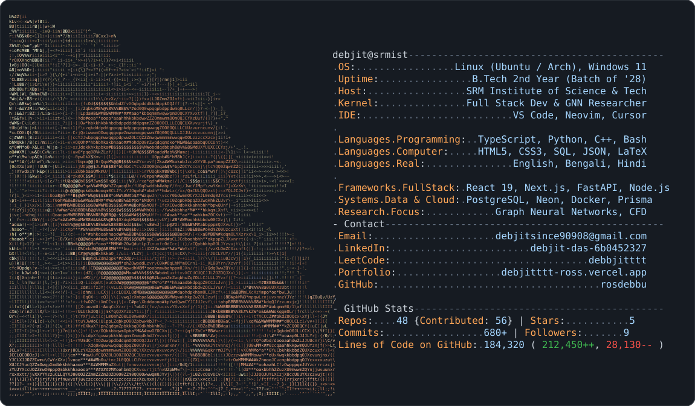
  </a>

  

  <a href="https://debjitttt-ross.vercel.app/"></a>
  <a href="https://www.linkedin.com/in/debjit-das-6b0452327/"></a>
  <a href="https://leetcode.com/u/debbjitttt/"></a>
  <a href="mailto:debjitsince90908@gmail.com"></a>

  

  <a href="https://github.com/rosdebbu/openzess">
    
  </a>

  

  

  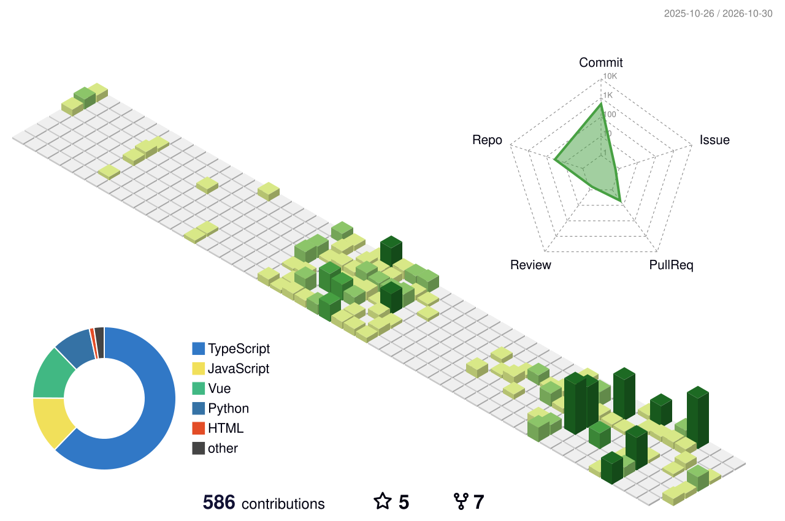

  <picture>
    <source media="(prefers-color-scheme: dark)" srcset="https://raw.githubusercontent.com/rosdebbu/rosdebbu/output/github-snake-dark.svg">
    <source media="(prefers-color-scheme: light)" srcset="https://raw.githubusercontent.com/rosdebbu/rosdebbu/output/github-snake.svg">
    
  </picture>

  <a href="https://github.com/rosdebbu?tab=repositories">
    
  </a>

  ⚡ Terminal-themed profile · Debjit (Ross) Das · 2026

