  

  

  
  
  
  

---

### 👋 About me

- 🎓 B.Tech CSE (Data Science) student at **SRMIST**, batch of '28
- 💻 Full-stack developer building production systems
- 🧠 Researching **Graph Neural Networks (GNNs)**
- 🚀 Currently building, learning, and shipping

---

### ⚙️ Currently building

**[Openzess](https://github.com/rosdebbu/openzess)** — Autonomous Agent Platform & Open Hardware Toolkit.
A production-grade full-stack system with a React dashboard, FastAPI backend, PostgreSQL (Neon) with connection pooling, a WebSocket matrix viewer, automated cron reporting, and codebase knowledge graph analysis.

---

### 🛠️ Tech stack

  
  
  
  
  
  
  
  
  
  
  
  
  
  
  
  
  
  
  

---

### 🔬 Research & systems

- 📄 **Graph Neural Networks** — spectral graph theory, message-passing networks, and graph-based representations for structured data
- 🦯 **ESP32 Smart Sensing** — embedded system for real-time environmental monitoring with sensor fusion and wireless telemetry
- 🌊 **CFD** — OpenFOAM wave simulations in Linux with custom mesh generation and ParaView post-processing

---

### 📊 GitHub stats

  
  

  ⚡ Terminal-themed profile · Debjit (Ross) Das · 2026

